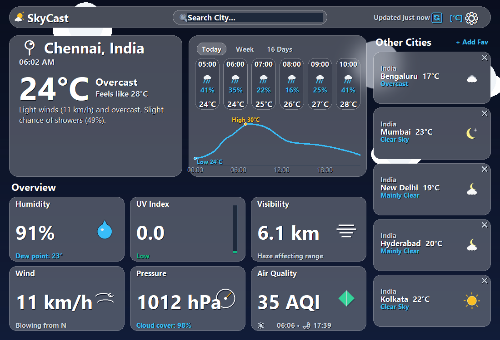

# ✦ SkyCast — Real-Time Weather Application


-007ACC)


A premium, atmospheric desktop weather intelligence application developed in **Python** using standard library **Tkinter** and **Pillow**. Designed with frosted glassmorphism, non-blocking 30 FPS particle animations, thread-safe asynchronous API streaming, interactive popover controls, and keyless data integration.

---

## 📸 Desktop Application Preview (Chennai, India — 1100×750)



---

## 🚀 Core Technical Highlights

- **Compulsory Tkinter GUI**: Built from scratch using standard Python `tkinter` and `Pillow`. Completely standalone with zero external GUI framework bloat (no PyQt, no Electron, no Kivy).
- **Zero API Keys Required**: Integrates directly with [Open-Meteo](https://open-meteo.com) for real-time weather, 16-day daily forecasts, 24-hour timelines, geocoding search, and European air quality metrics (AQI). No secrets or credentials needed.
- **Custom Canvas Glassmorphism**: Frosted glass panels generated with dynamic Pillow Gaussian blurs, soft white translucency tints, dark contrast backing, and thin borders. Cached by geometry to re-render only on window resizing.
- **30 FPS Non-Blocking Particle Animation Engine**: Smooth canvas particle rendering that runs strictly behind glass panels and above the atmospheric wallpaper:
  - 🌧️ **Rain with Splash Droplets**: Dynamic falling raindrops that create bouncing splash rings upon impact.
  - ⚡ **Thunderstorm with Branching Lightning**: Procedural branching bolts with momentary screen flashes.
  - ❄️ **Snow**: Swirling crystalline flakes with sinusoidal horizontal drift.
  - 🌫️ **Fog & Mist**: Soft horizontal haze bands drifting slowly across the viewport.
  - ✨ **Twinkling Starfield**: Pulsing night stars with realistic brightness oscillations.
  - ☁️ **Drifting Clouds**: Puffy cloud layers gliding across the horizon.
- **Thread-Safe Asynchronous Architecture**: All network requests run on daemon background worker threads and dispatch UI updates safely to the main Tkinter thread using `root.after()` and `queue.Queue`, completely eliminating GUI freeze.
- **Interactive Top-Bar Popover Menus**:
  - **`⛅ SkyCast` Brand Weather Logo**: Custom vector weather logo (golden sun behind cloud) that opens an **About SkyCast** modal with architecture specifications.
  - **`⚙` Settings Popover**: Frosted popover menu allowing instant toggling of **°C / °F**, one-click activation of all **F2 Weather Preview themes**, offline cache clearing, and restoring default Indian metro favourites.
- **Live Local Clock**: Automatically calculates the searched city's exact local time using Open-Meteo's `utc_offset_seconds` and updates live every 60 seconds.
- **24-Hour Temperature Trend Chart**: Smooth spline temperature curve drawn directly on canvas with padded min/max labels that never collide with the baseline time axis or clip the window edge.
- **Day / Night Vector Weather Icons**: Crisp vector icons rendered via Pillow. Automatically renders glowing crescent moons with twinkling stars (`moon`, `partly_night`) during night hours (<06:00 or >=18:00) instead of daytime suns.
- **10-Minute Auto-Refresh & Offline Fallback**: Keeps weather metrics fresh with auto-refresh timers, a manual `[🔄]` button, and automatic fallback to persistent JSON cache if connection drops (`⚠️ No connection — showing last saved data`).

---

## 📂 Project Organization

```text
RealTimeWeatherApp/
├── desktop/                    # Compulsory Python Tkinter Desktop Application
│   ├── app.py                  # Main entrypoint
│   ├── api_client.py           # Multithreaded Open-Meteo client (5s timeout)
│   ├── storage.py              # Local JSON persistence (units, favorites, cache)
│   ├── settings.json           # Active configuration & saved favorites
│   ├── assets/                 # Background wallpapers & verified screenshots
│   │   ├── backgrounds/        # Clear, cloudy, rain, snow, fog, thunderstorm wallpapers
│   │   └── skycast_stage5_5_chennai_1100x750.png
│   └── ui/
│       ├── main_window.py      # Tkinter master window, canvas layout & popovers
│       ├── panels.py           # Frosted glassmorphism PIL renderer & caching
│       ├── animations.py       # 30 FPS particle animation engine
│       ├── icons.py            # High-contrast Pillow vector icon generator
│       └── other_cities.py     # Favorites sidebar cards & management
├── shared/
│   ├── __init__.py
│   └── weather_codes.py        # WMO weather codes, theme palettes & AQI mapping
├── requirements.txt            # Python dependencies (Pillow, requests)
├── .gitignore                  # Git exclusions (__pycache__, .venv, settings.json)
└── README.md                   # Project documentation
```

---

## 💻 Installation & Setup

### Prerequisites
- Python 3.10 or higher.
- `pip` package manager.

```bash
# 1. Clone the repository
git clone https://github.com/naaaditya2007-tech/skycast-weather-dashboard.git
cd skycast-weather-dashboard

# 2. Install dependencies (Pillow and requests only)
pip install -r requirements.txt

# 3. Launch the desktop application
python desktop/app.py
```

---

## ⌨️ Controls & Shortcuts

| Control / Key | Action |
|:---|:---|
| **`Enter`** | Submit city search query in the search bar. |
| **`Escape`** | Clear search field and dismiss autocomplete suggestions. |
| **`[F2]`** | Cycle through all 8 atmospheric weather preview themes. |
| **`⚙` (Gear Icon)** | Open frosted glass Settings popover (units, previews, cache). |
| **`⛅` (Brand Logo)** | Open About SkyCast technical architecture popover. |
| **`[°C]` / `[°F]`** | Quick toggle between Celsius and Fahrenheit. |
| **`[🔄]`** | Manual instant refresh of current city and favorite cities. |
| **`+ Add Fav`** | Pin the currently viewed city into the favorites sidebar. |
| **`✕` on Card** | Remove a city from saved favorites. |

---

## 🇮🇳 Localized Default Cities

When launched for the first time, SkyCast opens with:
- **Default Home City**: **Chennai, Tamil Nadu, India** (`13.0827° N, 80.2707° E`, `Asia/Kolkata` +05:30).
- **Default Saved Favourites**:
  1. **Bengaluru**, Karnataka
  2. **Mumbai**, Maharashtra
  3. **New Delhi**, Delhi
  4. **Hyderabad**, Telangana
  5. **Kolkata**, West Bengal

---

## 📜 Acknowledgments & License

- Weather forecasting, geocoding, and air quality data provided by [Open-Meteo](https://open-meteo.com/).
- Distributed under the **MIT License**.
